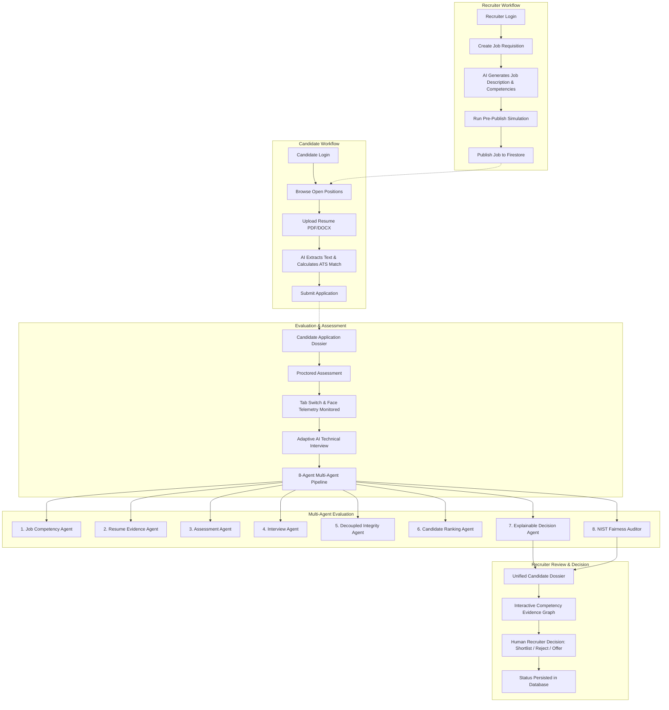

# HIRICA 2.0 — Complete System Workflow

**Platform Description**: HIRICA 2.0 is an AI-powered talent acquisition and evaluation platform that coordinates the recruitment workflow from job requisition drafting to candidate offer preparation.

---

## 1. What is HIRICA 2.0?

In traditional hiring, recruiters manually screen hundreds of resumes, send disconnected test links, conduct repetitive initial interviews, and manually compile notes across multiple spreadsheets and tools. This process is time-consuming, prone to human fatigue, and vulnerable to bias.

HIRICA 2.0 unifies the entire recruitment pipeline into a single auditable system using:
- **Generative AI** for drafting job descriptions and conversational technical interviews.
- **Document Processing (NLP)** for parsing resumes into structured competency evidence.
- **Proctoring Telemetry** for transparent integrity logging without uploading invasive video feeds.
- **Multi-Agent Evaluation** where specialized AI agents analyze separate parts of candidate qualifications.
- **Explainable Dossiers** presenting verified evidence to human recruiters, who make the final hiring decisions.

---

## 2. End-to-End System Workflow Diagram

---

## 3. How the System Works (Step by Step)

### Step 1: Recruiter Creates and Publishes a Job
1. The recruiter logs into the Recruiter Console.
2. The recruiter enters basic vacancy details: title (e.g. `AI/ML Engineer`), department, seniority, and primary skills.
3. The AI Job Intelligence module (powered by Groq LLaMA-3.1) generates a comprehensive role overview, daily responsibilities, and required competencies.
4. The recruiter configures interview and assessment stages, runs a simulation to estimate candidate pass-rates, and publishes the requisition to Google Cloud Firestore.

### Step 2: Candidate Discovers the Job and Applies
1. The candidate logs into the Candidate Career Portal.
2. Open jobs published by recruiters appear automatically in real-time.
3. The candidate clicks on a job and uploads their resume in PDF, DOCX, or TXT format.

### Step 3: Resume Text Extraction and Semantic ATS Matching
1. The backend uses **PyMuPDF** (`fitz`) and `python-docx` to extract raw text from the resume file.
2. The **Resume Evidence Agent** scans the text for specific competency evidence matching the job requirements.
3. The system calculates an objective ATS match score, highlights verified skills in green, identifies skill gaps, and generates an executive qualification summary.

### Step 4: Proctored Competency Assessment
1. If the job includes an evaluation phase, the candidate takes an online assessment.
2. Questions test multiple-choice knowledge, written architecture reasoning, and coding algorithms.
3. A live countdown timer controls the exam duration.
4. Upon completion, answers are evaluated against competency rubrics and saved to the candidate's application record.

### Step 5: On-Device Integrity & Proctoring Telemetry
1. During the assessment, the browser monitors focus events: tab switches, window minimizations, and clipboard paste attempts are logged as timestamped events.
2. If camera access is granted, Google MediaPipe (`@mediapipe/tasks-vision`) runs directly inside the candidate's browser to detect face presence or multiple individuals.
3. **Decoupled Privacy**: No video streams or photos are ever uploaded or stored in the cloud. Only discrete behavioral events (`TAB_SWITCH`, `NO_FACE_DETECTED`) are sent to the integrity log.
4. Telemetry is evaluated independently from coding ability so that non-malicious hardware glitches do not auto-fail a qualified candidate.

### Step 6: Adaptive AI Technical Interview
1. The candidate attends an interactive technical interview room.
2. The AI Interviewer asks targeted technical questions focusing on the candidate's specific background and any skill gaps identified during ATS screening.
3. The candidate submits their responses explaining their engineering reasoning.
4. The AI dynamically scores each answer turn (0–100%) and formulates relevant follow-up probes.

### Step 7: 8-Agent Multi-Agent Candidate Evaluation
When all stages are completed, HIRICA runs an autonomous 8-agent evaluation pipeline:
1. **Job Competency Agent**: Weights the core competencies demanded by the position.
2. **Resume Evidence Agent**: Finds concrete verifiable evidence in the candidate's CV.
3. **Assessment Agent**: Evaluates the candidate's test score and question coverage.
4. **Interview Agent**: Assesses the candidate's reasoning depth in the interview.
5. **Integrity Agent**: Computes a Trust Index (0–100%) based on recorded telemetry.
6. **Ranking Agent**: Calculates a weighted composite score (40% ATS + 50% Test + 10% Trust).
7. **Decision Agent**: Synthesizes the findings into an explainable recommendation (`STRONG HIRE`, `HIRE / INTERVIEW`, or `REJECT`).
8. **Fairness Auditor**: Evaluates the decision against **NIST Trustworthy AI** standards, checking that evaluations are grounded in objective skills with zero demographic proxy bias.

### Step 8: Unified Candidate Intelligence Dossier
1. The recruiter opens the candidate's dossier in the workspace.
2. Instead of reviewing fragmented notes, the recruiter sees all evidence in one place:
   - ATS match percentage and verified skills.
   - Proctored assessment score and answers.
   - AI interview transcript and turn-by-turn feedback.
   - Behavioral integrity timeline.
   - 8-agent breakdown and NIST fairness verification.
   - Interactive Competency Evidence Graph.

### Step 9: Human-in-the-Loop Recruiter Decision
1. HIRICA never replaces the human hiring manager. The AI provides an auditable recommendation, but the human recruiter makes the final call.
2. The recruiter can:
   - **Unlock Assessment**: Advance candidate to the testing stage.
   - **Shortlist Candidate**: Mark for team review.
   - **Prepare Offer**: Draft formal compensation, equity, and start date terms.
   - **Reject Application**: Archive with feedback.
3. All decisions and offer details are securely saved in Cloud Firestore and persist across all browser sessions.

---

## 4. Main Technologies Used

| Technology | Role & Purpose in HIRICA 2.0 |
| :--- | :--- |
| **React 18 + TypeScript** | Delivers the modern architectural CAD blueprint frontend interface. |
| **Vite 5** | High-performance build tool and local development server. |
| **Python 3.12 + FastAPI** | High-speed asynchronous backend API handling AI orchestration and file parsing. |
| **Groq Cloud (LLaMA-3.1)** | Ultra-low latency Large Language Model inference for job drafting and interview dialogue. |
| **Firebase Auth** | User authentication with role tagging (Recruiter vs. Job Seeker). |
| **Google Cloud Firestore**| Real-time cloud NoSQL database persisting jobs, applications, assessments, and offers. |
| **PyMuPDF (`fitz`)** | C-based document parsing engine extracting text from PDF resumes. |
| **python-docx** | Document extraction engine for Word resume formats. |
| **Google MediaPipe** | Client-side WebAssembly face detection library for privacy-preserving proctoring. |
| **Pytest** | Automated test runner verifying backend endpoints and role authorization. |

---

## 5. Summary of Core Differentiators

1. **Evidence-Grounded ATS**: Scores are backed by extracted bullet points, not opaque keyword counts.
2. **Pre-Publish Simulation**: Helps recruiters audit candidate drop-off before posting a job.
3. **Privacy-Preserving Proctoring**: Runs on-device via MediaPipe; zero video files uploaded to servers.
4. **Decoupled Scoring**: Separates behavioral telemetry from coding skills.
5. **Adaptive AI Interviewing**: Probes specific skill gaps rather than asking static question lists.
6. **NIST AI Fairness Auditing**: Ensures decisions are explainable and free of demographic proxy bias.
7. **Unified Candidate Dossier**: Centralizes the complete hiring trail into one recruiter view.
8. **Human Accountability**: AI assists and explains; human recruiters make the binding hiring decisions.
