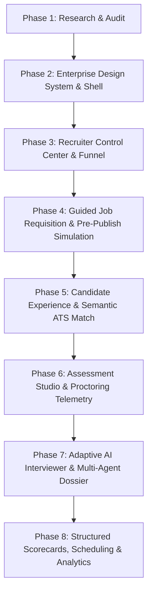

# HIRICA Product & Technical Roadmap: AI-Powered Talent Acquisition Intelligence Platform

**Author:** HIRICA Systems Architecture & AI Research Group  
**Date:** October 2026  
**Document Version:** 1.0  
**Target:** Final-Year AIML Capstone Project & Enterprise SaaS Benchmark  

---

## 1. Vision & Architectural Objective

HIRICA is an **AI-native Talent Acquisition Intelligence Platform** engineered to combine the operational rigor of enterprise recruiting systems (Workday, Greenhouse, Ashby) with novel, transparent artificial intelligence. Rather than functioning as a black-box scoring algorithm or an administrative template, HIRICA provides an end-to-end hiring journey:
* **Recruiters** configure guided requisitions, customizable pipelines, proctored assessments, and structured evaluation rubrics.
* **Candidates** experience frictionless job discovery, multi-format CV parsing, transparent application tracking, adaptive AI interviewing, and skill-gap developmental feedback.
* **The Intelligence Layer** (8 specialized AI agents) synthesizes evidence across resumes, assessments, and interviews into an explainable **Candidate Dossier** backed by a **Competency Evidence Graph**, fair integrity telemetry, and automated bias auditing.

---

## 2. Phased Implementation Roadmap

Development follows a strict, verification-driven sequence. Each phase preserves working functionality, builds upon the unified architecture, and is validated by automated build and runtime checks before advancing.

---

### Phase 1: Landscape Research & Architectural Audit *(Completed)*
* **Objective:** Benchmark leading talent acquisition suites, categorize features into 5 functional tiers, and verify the current codebase status.
* **Deliverables:**
  * `docs/research/competitive-landscape.md` (Benchmarking 17 platforms across 13 dimensions).
  * `docs/research/hiring-feature-matrix.md` (5-tier classification and code audit against `api/` and `src/`).
  * `docs/research/hirica-product-roadmap.md` (Technical roadmap and project milestones).
* **Verification:** Repository audit verified that the FastAPI backend (`api/main.py`) and Vite frontend (`src/`) run independently and concurrently from the project root.

---

### Phase 2: Enterprise SaaS Design System & Unified Application Shell *(Immediate Next Phase)*
* **Objective:** Transform the visual identity from a basic card/notebook template into a modern, authoritative enterprise SaaS interface inspired by Ashby, Linear, and modern Workday Redwood.
* **Key Components:**
  * **Design Tokens (`src/styles/` & `tailwind.config.js`):** Deep slate/midnight backgrounds (`#0B0F19`, `#111827`), refined emerald/indigo primary accents, crisp neutral typography (Inter / Outfit), high-density data tables, and subtle status indicators (Applied, Review, Assessment, Interview, Offer, Rejected).
  * **Unified Shell (`src/components/layout/`):** Enterprise sidebar navigation with role-aware switcher (Recruiter Workspace vs. Candidate Career Portal), persistent breadcrumbs, global requisition selector, quick action palette, and system status indicator.
  * **Standard UI Atoms:** Action buttons (Primary, Secondary, Danger, Ghost), status badges with dot indicators, high-density data tables with sorting/filtering, modal dialogs, and structured empty states.
* **Acceptance Criteria:** `npm run build` passes with zero type errors; layout renders cleanly on desktop, tablet, and mobile; recruiter and candidate navigation cleanly separated.

---

### Phase 3: Recruiter Control Center & Requisition Pipeline
* **Objective:** Transform `src/pages/Dashboard.tsx` and `src/pages/Applications.tsx` into a high-density, actionable command center.
* **Key Components:**
  * **Real-Time Funnel Analytics:** Conversion metrics across application stages (Applied -> Screened -> Assessment -> Interview -> Offer) calculated directly from live Firestore applications.
  * **Hiring Bottlenecks & Overdue Actions:** Surface applications waiting >48 hours for review, upcoming interviews, and pending assessment evaluations.
  * **Pipeline Kanban & High-Density Table:** Dual-view candidate pipeline with one-click stage progression, bulk actions, and search/filter by skill, status, or job.
* **Acceptance Criteria:** Metrics computed from live backend data; clicking any funnel metric or bottleneck item immediately filters the candidate view.

---

### Phase 4: Guided Job Requisition Wizard & Pre-Publish Simulation
* **Objective:** Provide a multi-step job creation experience featuring AI assistance and the pre-publish simulation innovation.
* **Key Components:**
  * **Multi-Step Wizard (`src/pages/JobManagement.tsx`):**
    1. *Role Information & Competencies:* Title, department, seniority, salary band, required skills, preferred qualifications.
    2. *AI Job Description Generator:* One-click Groq generation with live editing.
    3. *Hiring Stages & Assessment Configuration:* Select interview rounds, assessment types (MCQ, Written, Coding), difficulty, and proctoring rules.
    4. *Structured Evaluation Scorecard:* Define stage-specific evaluation criteria and question prompts.
  * **Innovation F (Pre-Publish Hiring Simulation):** An automated pre-flight audit that inspects the requisition before publication:
    * Flags missing competencies not covered by the configured assessment or interview.
    * Warns of excessive candidate time burden (>60 min assessment).
    * Validates question count, difficulty, and scoring rubric completeness.
* **Acceptance Criteria:** Full requisition draft saved to Firestore; simulation report renders with actionable optimization suggestions prior to final publish.

---

### Phase 5: Candidate Experience, Job Discovery & Semantic ATS Feedback
* **Objective:** Polish candidate career discovery (`src/pages/Jobs.tsx`, `JobDetail.tsx`, `ApplyJob.tsx`) and provide evidence-grounded ATS feedback.
* **Key Components:**
  * **Career Discovery Portal:** Modern job board with role filters, location tags, and transparent compensation badges.
  * **Application & Multi-Format CV Upload:** Frictionless apply flow with drag-and-drop resume upload (PDF, DOCX, TXT) parsed via PyMuPDF/python-docx.
  * **Evidence-Grounded ATS Matching:** Live resume evaluation comparing candidate skills against job requirements, highlighting matched skills, evidence citations, and identified gaps.
  * **Innovation H (Candidate Development Feedback):** Candidate portal displays constructive skill-gap insights and recommended learning areas without revealing confidential internal evaluation scores.
* **Acceptance Criteria:** Resumes reliably parsed; candidate dashboard displays application progress timeline without leaking recruiter notes.

---

### Phase 6: Assessment Studio & Integrity Telemetry
* **Objective:** Elevate the assessment creation and candidate test-taking experience with fair proctoring telemetry.
* **Key Components:**
  * **Assessment Builder (`src/pages/AssessmentManagement.tsx`):** Configure question formats (MCQ, written open-ended, coding), difficulty levels, time limits, and preview generated Groq questions.
  * **Candidate Assessment Runner (`src/pages/TakeAssessment.tsx`):** Distraction-free exam room with live countdown timer, auto-save, code editor, and smooth submission.
  * **Client-Side Integrity Telemetry:** Background logging of tab switches, window blurs, and paste events with precise timestamps sent to `api/main.py:record_proctoring_event`.
  * **Innovation D (Integrity-Aware Fair Evaluation):** Backend `IntegrityAgent` evaluates event logs to distinguish innocent navigation glitches from systematic cheating, keeping integrity risk isolated from demonstrated skill scores.
* **Acceptance Criteria:** Assessment submissions auto-graded (MCQ answer keys, written semantic rubric, code validation); integrity report securely attached to the candidate dossier.

---

### Phase 7: Adaptive AI Interviewer & Multi-Agent Candidate Dossier
* **Objective:** Deliver HIRICA's signature technical contributions: the conversational adaptive interview and the explainable intelligence dossier.
* **Key Components:**
  * **Adaptive AI Interviewer (`src/pages/InterviewPage.tsx` & `api/ai/interview/`):**
    * Multi-turn conversational interview aware of the candidate's CV and prior assessment answers.
    * Generates targeted technical follow-ups to probe unverified skills.
    * Transcripts persisted in Firestore with turn-by-turn rubric evaluations.
  * **Signature Screen: Candidate Intelligence Dossier (`src/pages/CandidateDossier.tsx`):**
    * Synthesizes outputs from the 8 specialized agents into a single unified dossier.
    * **Innovation C (Competency Evidence Graph):** Interactive visual graph connecting job competencies -> resume evidence -> assessment answers -> interview responses.
    * **Innovation A (Evidence-Based Recommendation):** Recruiter recommendation (Strong Advance, Advance, Hold, Reject) with transparent rationale citing specific evidence.
    * **Innovation G (Fairness & Governance Audit):** Automated fairness report documenting evaluated factors, demographic proxy checks, and score consistency.
* **Acceptance Criteria:** Live interview completes across configured turns; candidate dossier visualizes all 8 agent outputs with full evidence traceability.

---

### Phase 8: Structured Scorecards, Scheduling & Recruitment BI Analytics
* **Objective:** Complete the platform with enterprise workflow tools: structured scorecards, calendar coordination, and advanced analytics.
* **Key Components:**
  * **Structured Scorecard Kit:** Standardized interview evaluation forms with 4-point rating scales and mandatory written evidence justification.
  * **Interview Coordination & Calendar Export:** Schedule interview rounds, assign team interviewers, and generate downloadable `.ics` calendar invites.
  * **Recruitment BI & Bottleneck Analytics:** In-depth analytics dashboard displaying source yield, pass-through rates, time-to-hire, and stage delay bottlenecks.
* **Acceptance Criteria:** Scorecard submissions update application dossiers; calendar invitations download successfully; analytics drill-down links to relevant requisitions.

---

## 3. Academic & AIML Capstone Project Positioning

To stand out in academic evaluations, HIRICA highlights seven concrete scientific contributions:
1. **Multi-Agent Orchestration Architecture:** 8 specialized agents communicating through structured JSON schemas rather than a monolithic, unstructured prompt.
2. **Explainable AI (XAI) in Hiring:** Grounding every recommendation in concrete evidence (resume lines, code test cases, interview quotes) to eliminate black-box scoring.
3. **Adaptive Formative Assessment:** Dynamic question generation informed by prior performance to maximize information gain during evaluation.
4. **Competency Evidence Knowledge Graph:** Graph representation mapping semantic relations between job competencies, candidate claims, and empirical evaluation data.
5. **Decoupled Integrity Telemetry:** Fair algorithmic separation between technical competency scores and proctoring behavioral telemetry.
6. **Algorithmic Fairness Auditing:** Automated detection of proxy bias and score distribution anomalies across candidate cohorts.
7. **Simulation-Driven Workflow Optimization:** Pre-publish verification of requisition coverage using simulated applicant profiles.

---

*End of HIRICA Product & Technical Roadmap.*
